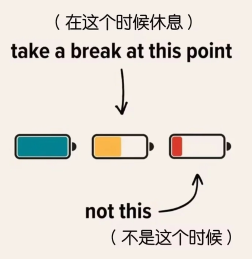
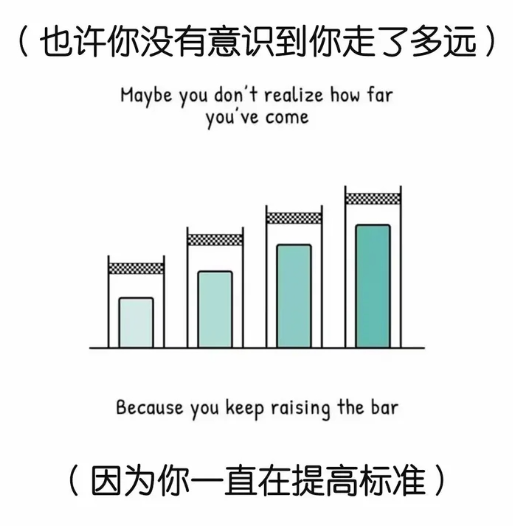

# 引言

其他

* [b 站 Wiki 引言](https://wiki.biligame.com/celeste/%E6%96%B0%E6%89%8B%E5%BC%95%E5%AF%BC)
* [Discord 教程合集引言](https://docs.qq.com/sheet/DSHBRcE5pUWtnckJj?tab=000002&_t=1749608615623&nlc=1&u=63af408ccdfa42feac91b9fed2efa2c3)
* [努力](https://www.xiaoheihe.cn/app/bbs/link/b14a727f1255)

## 你为何而来

[//]: # (动机角度)

* 有的人是[创作欲望](https://www.bilibili.com/video/BV1p2T1zPEJE/)想要表达, [压抑情绪](https://www.bilibili.com/video/BV1Tu411s7kG/)想要发泄
* 有的人单纯想以制图形式送给朋友做个[礼物](https://www.bilibili.com/video/BV1Z84y1n7KQ)
* 有的人只是来[拉屎](https://www.bilibili.com/video/BV1TWY1zgEt7)创造抽象乐趣
* 有的人只是想[体验一下制图的感觉](https://www.bilibili.com/video/BV1a5hczDEBy/)
* 等等等等

当然情况也可能很波折, 以我自身为例, 我当初只是一个普通的蔚蓝玩家, 因为某些原因来到制图群偷点蔚蓝图片素材,
却阴差阳错之下遇见了 [Saplonily 的代码教程](https://saplonily.top/celeste_modding_tutorial/code_modding/), 不过因为能力不够不太懂, 所以就干别的去了, 我本来已经忘记这件事了,
但是在磨练一段时间的技术后, 仿佛是命中注定一般, 我在某一天突然又搜到 [Saplonily 的代码教程](https://saplonily.top/celeste_modding_tutorial/code_modding/)了! 于是我开始学习制作 Mod,
然后我发现做 Mod 好有意思! 帮助别人给别人写实体也好有意思! 结果我很自然的就喜欢上了蔚蓝 Mod 制作并且选择留在这个社区里

其实动机怎么样一点也不重要, 关键是 **你知道自己为何而来吗?**

## 地图的组成

如果你准备好开始了, 那就让我们先来认识一下一张蔚蓝地图的大致组成部分吧

### Gameplay

简称 GP, 即游戏玩法, 它的含义非常的广, 游戏操作, 动作交互, 整体玩法都涵盖在内, 比如 [Me and the Birds](https://www.bilibili.com/video/BV13iLGz3ELu/) 这种以弹球抛接 GP 为主要玩法的图

<figure>
  
  <figcaption>西西弗斯来了</figcaption>
</figure>

Gameplay 品类众多, 它们的内涵相互交织, 又有细微区别, 所以以下提供了一种不严谨不完整的分类思路, 仅供参考

#### 实体交互

> 玩家在游玩过程中能明显感受到这张图的设计是围绕某些实体所展开的
>
> 这不仅能奠定 GP 的主基调, 还能深挖一个实体的特性, 循序渐进的提高难度, 不至于让玩家一下子被多种类型的实体淹没

* [余烬山脊](https://www.bilibili.com/video/BV1QQpn6qEvD/): areo 块
* [崩碎之歌](https://www.bilibili.com/video/BV1YgLe6tEyH/): 变奏节奏块
* [逐色寻光](https://www.bilibili.com/video/BV1Zk8s61E1N): 速度变向实体
* [Slnvovhh](https://www.bilibili.com/video/BV1JMwdzGEca/): 掉落块 + 灰砖
* [Up the Amethyst Trail 紫晶山道](https://www.bilibili.com/video/BV11un36tE63/): 紫水晶
* [反转山脊](https://www.bilibili.com/video/BV1Qc411E7rq/): 前景砖/背景砖切换 + 果冻水晶

#### 特定操作

> 专注于特定操作, 实体主要只是实现操作的一种手段

* [The Solar Purgatory 烈冕炼狱](https://www.bilibili.com/video/BV11wnderEFi/): 高级抛接技巧 + 高级弹球技巧
* [\/ SYSTEM MELTDOWN \/](https://www.bilibili.com/video/BV1r8g96mEKe): 高速垂直运动, `Bounce Helper` + `Ceiling Ultra`
* [Aphelion 远日](https://www.bilibili.com/video/BV1TBu26KEX9/): 冻结帧松抓
* [NACG](https://www.bilibili.com/video/BV1RFHUzAEbC): 微操
* [514 连 反 凌 波 兔 子 跳](https://www.bilibili.com/video/BV1wPhtzVE8K/): 重复, 重复, 重复

#### 解密

> 呃啊, 我的脑细胞

* [Debug map](https://www.bilibili.com/video/BV1hJB7YqEm2): 纯解密
* [迷失森林](https://www.bilibili.com/video/BV1vT421i7LN/): 路线解密
* [子机](https://www.bilibili.com/video/BV1nC8K6AEpB/): 双拼解密

#### 实验性玩法

> 相对少见偏创新的玩法

* [When Push Comes to Shove](https://www.bilibili.com/video/BV1YaKX6XEyz/): 玛德琳不动, 操控机关
* [魂斗罗式射击](https://www.bilibili.com/video/BV1Rq4y1o7LT/)
* [Twisted Pair](https://www.bilibili.com/video/BV1MAxWzfErD/): 玛德琳 + 坏德琳的双生图
* [Swimming](https://www.bilibili.com/video/BV1cLJEz9Ejo/): 钩爪 + 鞘翅 + 骨钉
* [Elytra Studio](https://www.bilibili.com/video/BV1Nu4y157fA/): 纯音乐
* [NULCTRL](https://www.bilibili.com/video/BV13cBSBnEsE/): 音乐踩点
* 等等

总之, 你这张图在玩法上应该要有一个 **鲜明的记忆点**, 就像提到弹球大家都会想到[弹球炼狱](https://www.bilibili.com/video/BV14nXBYtEf3/?t=12),
提到节奏块大家都会想到[崩碎之歌](https://www.bilibili.com/video/BV1YgLe6tEyH/), 提到煤球大家都会想到 [(举例了一些煤球图)](https://www.bilibili.com/video/BV1Fc411G7qs/)

哪怕做不到耳濡目染, 至少也应该要让玩家有个印象, 一个 GP 可能很屑但大家就是记住了, 反之玩的很舒服的 GP 反而玩家可能就只记得舒服了, 当然你可以既做得舒服又有记忆点, 但这需要经验

    
注意

    
把你选定的 GP 正确传达给玩家也需要一定的技巧, 你可以从<a href="https://www.bilibili.com/video/BV1VApX6hEDT/">究竟怎样才算好的玩法教学</a>中获取灵感

### Music

> 这里泛指背景音乐/环境音/音效

音乐搭配装饰奠定了整体的氛围基调, 比如

<audio controls>
    <source src="/celeste_wiki/assets/mappings/introduction/music.mp3" type="audio/mpeg">
    Your browser does not support audio.
</audio>

* [新年核心](https://www.bilibili.com/video/BV1P1Nie2Ege/?t=1408)中的踩点和激昂的音乐让人兴奋, [新年核心](https://www.bilibili.com/video/BV1P1Nie2Ege/?t=1932)的上升段搭配空灵音乐让人落泪
* [氛围测试图 by DeepBlueBerry](https://www.bilibili.com/video/BV1UGKEeuEmv/) 中传达出的凄凉感
* [命日 (Meinichi)](https://www.bilibili.com/video/BV1KhGB6SEWU/) 中传达出的混沌感
* [百香万神殿](https://www.bilibili.com/video/BV1p5pxzEEaG/?t=826) 结尾传达出的神圣感
* [The Solar Purgatory 烈冕炼狱](https://www.bilibili.com/video/BV11wnderEFi/?t=237) 中传达出的神圣/挑战/试炼感
* [Me and the Birds](https://www.bilibili.com/video/BV13iLGz3ELu/) 中传达出的无力感
* [Glyph 象形](https://www.bilibili.com/video/BV1er4y1f7gi/) 中传达出的身临其境感
* [奥日与萤火意志-水磨坊逃亡](https://www.bilibili.com/video/BV1pzhLenEMd/), [奥日与黑暗森林-银之树逃亡](https://www.bilibili.com/video/BV1sh411679F/)中的音乐和 GP 的搭配给人劫后余生的震撼
* 等等

总之, 你这张图在音乐上应该要有一个 **鲜明的记忆点**, 只有合适的音乐, 没有绝对好的音乐, 比如[崩碎之歌](https://www.bilibili.com/video/BV1YYwEz8EJf/)中看似没有规律但又有点规律的叮叮当当的节奏块却能渲染出压抑的氛围

### Decoration

> 我一直在哭😭

装饰搭配音乐奠定了整体的氛围基调, 比如[致我所热爱的一切](https://www.bilibili.com/video/BV1AMHi6FE1b/)中给人带来的空灵梦幻的感觉

<figure>
  
  <figcaption>我的天哪这简直太美了</figcaption>
</figure>

* [画境](https://www.bilibili.com/video/BV1x1421r7ya/) 给人温暖和谐的感觉
* [愿逐月华流照君](https://www.bilibili.com/video/BV1MwdVBRE6q/?&t=142) 给人夜晚宁静的感觉
* [Sorrow of Forgotten Piano](https://www.bilibili.com/video/BV1XRtZ6ZEZX/): 雨中漫步 (就是雨有点晃眼)
* [A New Dawn](https://www.bilibili.com/video/BV1Qd4y1P7vY/): 漫步在黎明的古迹

总之, 你这张图在画面上应该要有一个 **鲜明的记忆点**, 只有合适的画面, 没有绝对好的画面, 比如 [Sonder](https://www.bilibili.com/video/BV1ZZDHBSEsq/?t=163)
中的彩色玻璃窗和透过的有着细微颜色差异的光线让你感到温暖和真实, [Sheepy A Short Adventure](https://www.bilibili.com/video/BV11oen6WEs9/?t=594) 前景的黑影让你体会到空间的纵深感

### Dialog

对话能快速营造真实感, 让游戏里的角色 **活** 起来, 比如 [Journeys of a Bygone Wanderer](https://www.bilibili.com/video/BV1SbWSe6EAT/),
又或是[带上她的眼睛](https://www.bilibili.com/video/BV1Y5B5B9E5Q/)

<figure>
  
  <figcaption>乐观的 Theo</figcaption>
</figure>

Dialog 也可以用来快速营造神秘感, 比如[留下一些奇奇怪怪的纸条](https://www.bilibili.com/video/BV1tF15YuEaS/?t=560)

还可以单纯用来提示操作技巧, 比如[技巧说明告示板](https://www.bilibili.com/video/BV1iN411E7ux/?t=12)

又或是充当[旁白](https://www.bilibili.com/video/BV1MwdVBRE6q/?t=529), 描述画面和动作

### Camera

镜头能帮你看清前方的道路, 同时它也是叙事和营造氛围的好帮手

<figure>
  
  <figcaption>大就是好</figcaption>
</figure>

比如

* [Sheepy A Short Adventure](https://www.bilibili.com/video/BV11oen6WEs9/?t=571) 中突然变大的画面初见美得让人说不出话
* [Mount Tin](https://www.bilibili.com/video/BV1SVrhBuEAS/) 只用了一个大镜头就让人感受到了 Madeline 的渺小与无助
* [Journeys of a Bygone Wanderer](https://www.bilibili.com/video/BV1SbWSe6EAT/?t=243) 中镜头的移动和缩放能很好的传递情绪

## 你该做些什么

### 框架

如果你对做什么样的地图没什么思路的话, 这里提出一些构思上的方法论

一种建议是先想好一个很简单的故事, 比如 **玛德琳今天要爬山**, 然后从不同角度去拓充内容

* 人数: 一个人爬吗, 还是跟奶奶爬, 又或者是跟坏德琳拌嘴着爬, 会遇见 Theo 吗, 还是跟 Theo 一起爬等等
* 原因: 想散散心? 跟某人比赛? 意外事故 (比如坠入洞穴得重新爬出来)?
* 时间: 晚上爬还是白天爬, 还是分不清白天黑夜 (比如在洞穴里, 外太空), 从早爬到晚, 还是从晚爬到早
* 地点: 爬雪山, 熔岩山, 香蕉山, 冰激凌山, 爬弹球山, 爬 [1:1 珠穆朗玛峰](https://www.bilibili.com/video/BV1yfGE6ZEgv/), 爬香香软软的山, 爬会说话的山, 爬各种奇思妙想的山
* 天气: 下雨, 晴天, 阴天
* 温度: 寒冷, 炎热, 温暖, 凉爽
* 手段: 用脚爬 (常规 GP), 用道具爬 (喷气背包, 钩爪, 鞘翅), 挂机爬 (自动图)
* 等等

当你想好了地图的大体框架, 其中的音乐, 美术, 游戏玩法也能很快定下基调, 为你指明方向

### 难度

> 难不一定差, 简单不一定好

如果你清楚自己想要借作图表达什么, 难度就压根不是问题

你当然可以说我今天想写张酱三左右的图, 但是也没必要特别纠结现在的难度是酱二红还是酱三绿, 酱三红还是酱四绿, 就连草莓酱自己内部方差都大的一批呢, 所以别纠结难度, 放手去做吧

### [氛围](https://www.bilibili.com/video/BV1ZuG66rErj/)

[//]: # (想说的话感觉还能单开一个章节, 不过这些都是要慢慢积累的还是就讲这么多算了)

氛围是一项衡量玩家是否代入作品的指标, 如果哪怕有一瞬间能让玩家 **感受到自己处在对应的世界中**, 而不仅仅是在操控一个角色, 那么你做的氛围就绝对是成功的

所有的一切都可以拿来营造氛围, 不过大体上还是可以分为以下几类

* [视效方面](https://www.bilibili.com/video/BV1ZuG66rErj/?t=183): [Sonder](https://www.bilibili.com/video/BV1ZZDHBSEsq/?t=163)
  中的彩色玻璃窗营造和谐温暖的氛围, [愿逐月华流照君](https://www.bilibili.com/video/BV1MwdVBRE6q/?t=529)中营造出的带有顽强生命力的植物所蕴含的力量感

> 你知道吗, 蔚蓝 9a 的黑洞是能[被风吹动](https://www.bilibili.com/video/BV15v4y1X71E/?t=1892)的, 氛围往往就藏在这些小细节里

* [音乐方面](https://www.bilibili.com/video/BV1ZuG66rErj/?t=413): [崩碎之歌](https://www.bilibili.com/video/BV1YYwEz8EJf/) 中的节奏块带来压抑恐怖的氛围
* [GP 方面](https://www.bilibili.com/video/BV1ZuG66rErj/?t=535): [The Climb](https://www.bilibili.com/video/BV1tY4y1g7Dk/?t=10)
  通过较为开放的路线/严格的体力管控让人深深的感到攀登的艰辛, [Me and the Birds](https://www.bilibili.com/video/BV13iLGz3ELu/) 同理
* 镜头方面: [Mount Tin](https://www.bilibili.com/video/BV1SVrhBuEAS/) 只用了一个大镜头就让人感受到了 Madeline 的渺小与无助
* [剧情/世界观方面](https://www.bilibili.com/video/BV1ZuG66rErj/?t=708): [Journeys of a Bygone Wanderer](https://www.bilibili.com/video/BV1SbWSe6EAT/), [带上她的眼睛](https://www.bilibili.com/video/BV1Y5B5B9E5Q/)
  中的对话让你代入角色视角进入他们的世界

> 趣事一则: 带上她的眼睛在第一版的平原上放了一个[雷霆大瀑布](https://www.bilibili.com/video/BV1Y5B5B9E5Q/?t=666), 虽然画面很美, 但是显然这很不科学, 如果玩家意识到了这一点沉浸感就会被破坏,
> 所以在后续的迭代中增加了[悬崖](https://www.bilibili.com/video/BV1Y5B5B9E5Q/?t=800)这一结构, 既补全了平原上有瀑布的设定, 还能顺便增加点攀岩
> GP, 和剧情相辅相成

    
小贴士

    
值得注意的是, 创作者思维和玩家思维是有很大不同的, 你可能在玩一张图的过程中感觉好玩, 好看, 好听, 好哭, 但是无法明确那种感觉来自于哪里

    
体会并制造这些感觉并不容易, 但你要坚信这是值得的, 新世界的大门会为你打开, 你的眼里不再只有 GP

## 先完成, 再完美

[//]: # (启动角度)

> 其实我们并非完美主义者, 可为何你总是止步不前?
>
> 知识就像诅咒一样困扰着我们, 明明我们在利用知识分析问题, 但又被知识搞得束手束脚, 止步不前

我两年前很难想象 Wiki 居然能发展到如今的规模, 毕竟一个人编写这样的东西肯定是很困难的, 事实也确实如此, 但是好在有前人现成的教程可以用, 于是乎我可以在不添加任何 **实质性**内容的情况下搭建好
Wiki 整体的结构, 尽管一开始 Wiki 里满是蓝色的[链接](), 但这为后续打下了良好的基础

之后的工作就比较简单了, 看看群友有没有遇到什么困难, 如果 Wiki 无法帮他解决, 那就补充并修改内容, 如果哪天心血来潮, 可能会去研究一下某个板块的内容, 并以一个萌新的视角输出一下理解,
可能更容易让人阅读和消化

有意思的是, 编写 Wiki 的过程就像是在整理一团杂乱无章的线, 一开始的 Wiki 以现在的眼光来看绝对是屎, 但是随着内容的增多, 你能慢慢看到一些有相似特征的内容并将它们总结归纳到一个新的版块里,
各个知识点之间的联系也会慢慢显露出来, 你就可以通过[链接]()将他们串起来了, 于是乎, 一步一个脚印, Wiki 就在迭代中不断变得更好了!

以上是宏观视角, 我们再来看看微观视角, 比如我在写 Wiki 的时候经常就有一堆话想要说但又不知道怎么组织语言, 半天一个字也敲不出来, 但解决办法其实也很简单, 把想说的全部写出来,
然后再慢慢整理并组织语言, 真搞不定大不了睡一觉第二天起来再看看, 总比干坐着内耗不知道怎么写要好

总而言之, 在你没有完成一件事的时候, 你不太可能有一个很好的的大局观考虑到方方面面, 你觉得有的东西分开又太稀疏, 合起来感觉又不太对, 有没有可能是因为做的东西太少了, 以至于你怎么组织都无济于事,
你觉得一件事很困难有很多细节要考虑, 但有没有可能其中也有很多惊喜在等着你?

**所以先做起来吧, 事情总会慢慢变好的!**

<figure style="display: flex; gap: 1rem;">
  

       
  

  

       
  

</figure>

## 相信自己

[//]: # (坚持角度)

> 想做就大胆去做吧!

你有没有觉得蔚蓝圈子的力量过于分散了, 几乎所有的活动和知识都不能得到很好的保留, 这让我有一种不真实感, 明明那么多有意思的好的东西我都见过的, 但是想要的时候却找不到

所以我选择了撰写 Wiki, 一是我确实也有表达欲望, 二是我相信这个 Wiki 能做出有厚重感, 有历史底蕴的东西, 而不仅仅是教程的整合, 萌新能从中体会到站在前人肩膀上的感觉, 看到前人的智慧,
看到以前还发生过这么多好玩的事, 看得热血澎湃, 想要参与其中......

如果没有信念的话我是不可能坚持得下来的, 毕竟在 Wiki 刚起步那会儿 [Everest Wiki](https://github.com/EverestAPI/Resources/wiki) 在教程方面可以说是全方面碾压我们, 虽然我们当然可以举双手投降,
当一个普通的潜水群友

{style="width:400px"}

其实哪怕是 "从零开始", 我们依然能发现前人所遗漏的东西, 并且尝试做得更好, 更别提研究这些事情本身也是有乐趣的, 而不全是重新造轮子的痛苦, 退一万步讲, 咋们的 Wiki 再怎么说也把该整合的链接整合了,
写得再烂那不也还是可以充当一个快速索引的渠道吗😋

## 学会区分感受

* 你知道 **累** 的感觉是怎么样的吗
* 你知道 **难** 的感觉是怎么样的吗
* 你知道 **讨厌** 的感觉是怎么样的吗
* 你知道 **喜欢** 的感觉是怎么样的吗
* 你知道 **无感** 的感觉是怎么样的吗
* 你知道 **无聊** 的感觉是怎么样的吗

他们的诱因往往各不相同, 而他们带给人的感觉却又如此相似

* 你可能因为跟 **讨厌** 的人待在一个圈子里而难受, 这种难受的感觉充斥着你的大脑, 导致你在做喜欢的事情的时候也可能会 **感到** 厌烦, 进而可能得出 "我是不是不喜欢这件事了" 的离谱结论
* 你可能在学习一项新技术的时候感到非常快乐, 这种快乐不断持续并外化到了人身上, 你最终可能会得出 "大家都挺和善的" 的结论, 但其实对方也很有可能是个傻逼
* 你可能在学习一项新技术的时候同时感到难/累, 然后误认为这种感觉是不好的信号, 从而得出自己不喜欢这件事的结论
* 你可能一开始只是觉得制图有点意思, 做了张图之后得到了一些关注, 你以为快乐来自于关注, 结果你为了得到更多的关注选择去做了更多的图, 你的技术在不断提升, 但你却再也快乐不起来了
  (可以参考[德西效应](https://baike.baidu.com/item/%E5%BE%B7%E8%A5%BF%E6%95%88%E5%BA%94/6133934))
* 你可能......

所以你要学会细细品味并分析自己的感受, 把不同的成分抽离出来, 这样你才能堂堂正正的去喜欢和讨厌一个东西, 一件事, 一个人

## 抽离他人

> 厌恶啊, 这些人怎么就这么贱
>
> 无奈啊, 你为什么这么不争气
>
> 绝望啊, 我该如何改变这一切

我们在圈子里难免会遇见

* 各种各样的傻逼, 就知道阴阳怪气, 说风凉话 (无论资历)
* 各种各样让自己感到可惜的人, 明明可以做的更好, 明明不需要这样的

你看到了傲慢, 麻木, 冷漠, 怠惰, 功利, 怯懦, 你渴望改变, 并采取行动, 但似乎收效甚微,
你不信邪, 你努力着, 呐喊着, 结果换来的却是连你自己都迷失了

这也是没办法的嘛, 人家变成现在这逼样都是从小到大的环境一步步熏陶出来的, 这不是短时间内扯扯嘴皮子就能让别人的价值观跟你对上的, 
所以啊, 有的时候学着自私一点也不是啥坏事, 不如把精力剩下来留给更值得的人, 不然你就是把自己烧成灰了也没法儿照亮他人

## 学会休息

> 累了就要休息, 一味的硬撑只会适得其反

娱乐是娱乐, 休息是休息, 刷视频不是休息, 听音乐也不是休息, 它们只是放松的工具, 不能让你恢复精力

如果你真累了, 其实只需要趴桌子上眯个十来分钟半个小时就够了

{style="width:400px"}

## 减少对比

> 别人是别人, 我们是我们

天天跟别人比来比去累不累啊

{style="width:400px"}

## 酒香也怕巷子深

虽然我承认装作是一个高手并且在无意间透露出自己的作品并得到别人的夸奖甚至是大力宣传的感觉无疑是很爽的, 但事实是除非真的质量高到离谱, 大多数时候你的作品究竟怎样其实并没有人关心,
所以如果你坚信自己做的是对的, 是好的, 那么偶尔"推销"一下自己的东西也没什么丢脸的

虽然上文提到成果不论大小在观众眼里都是蛋糕, ~~但是有没有观众是另一回事儿~~

## 记住当下的感觉

大家有没有发现在我们独立做完一件大事以后一般都会觉得索然无味, 虽然技术在不断精进, 但是后续再做同样事情却再也找不回当初的热情了, 而且往往规模也大不如从前, 这可能会导致你怀疑自己是不是变菜了,
是不是不喜欢这件事了

但实际上这是因为第一次做的时候太爽了, 一是很多东西都是第一次接触很新鲜, 二是我们倾尽了自己的热情和想象力, 这让快乐/热情达到了前所未有的高度, 显得后续的快乐/热情比较渺小而已

所以一种建议是专注于当下, 让自己在后续的接触中积累点点滴滴微小的快乐, 不要因为现在没有第一次那么兴奋, 就认定自己已经失去了热爱

## 其实我们很健忘

有的时候我们在一条路上走得太久太久了, 久到我们自己都忘了当初是怎么踏上这段旅途的, 所以如果你不小心迷失了, 不妨回头看看来时的路

## 写在最后

制图不仅仅是制作地图, 也是一段认识自己、探索未知、与他人相遇的旅程. 我们可能因为一时兴起而入坑, 因为某项技术而沉迷, 也可能在不断实践的过程中, 逐渐发现自己真正想要的东西.

这一路上, 我们会遇到困难, 会感到疲惫, 会因为他人的评价而动摇, 也会发现曾经无比热爱的事情似乎不再那么有趣. 但这些都不意味着我们走错了路. 重要的是学会分辨自己的感受, 理解自己的追求,
在需要的时候调整方向, 而不是轻易否定过去的自己.

不必一开始就想清楚所有事情, 也不必急着证明自己. 先做起来, 在实践中积累经验, 在尝试中发现可能, 在一次次修改与完善中留下属于自己的作品. 比起一味追求完美, 更重要的是始终保有探索的勇气,
以及重新出发的能力.

**愿你不只是做出自己喜欢的地图, 也能在这段旅程中, 找到自己喜欢的生活方式.**
